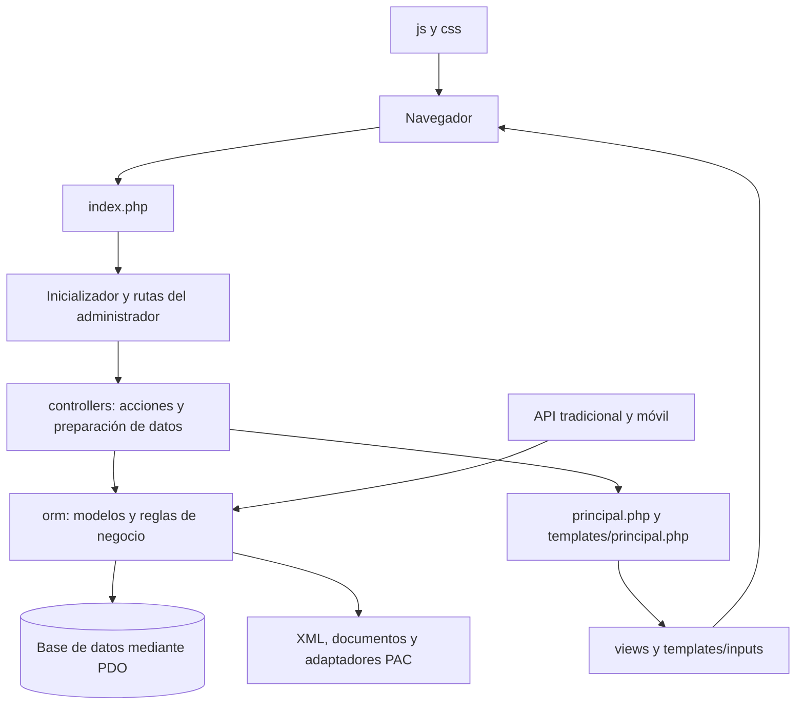

# Equipo y arquitectura de Facturación

## Cómo utilizar el equipo

El chat principal coordina cuatro especialistas: `backend`, `frontend`, `revisor` y `calidad`. Se activan hasta tres especialistas simultáneamente junto al coordinador; las revisiones restantes se realizan por turnos. Sus perfiles están en `.codex/agents/`; las reglas comunes y los comandos están en `AGENTS.md`. Los perfiles conservan el modelo y esfuerzo de la sesión salvo selección explícita. Los agentes heredan sus permisos: estas instrucciones no amplían acceso al sistema.

Pide un resultado concreto en un chat cuyo proyecto principal sea este repositorio. Por ejemplo:

> Revisa el alta de factura. Coordina backend y frontend para identificar el flujo y pide al revisor comprobar las pruebas existentes. Devuelve un diagnóstico con archivos y evidencia.

Para una implementación:

> Implementa [comportamiento observable]. Define primero el contrato entre backend y frontend, asigna archivos sin solapamientos y encarga al revisor verificar la versión integrada. Entrega los resultados de las comprobaciones y los pendientes.

Los perfiles son instrucciones reutilizables, no procesos permanentemente activos. El coordinador inicia los subagentes cuando el trabajo se beneficia de delegación. La actividad se realizó con tres agentes para la inspección inicial de este proyecto. Para sesiones futuras, abre el proyecto desde la raíz de este checkout para que Codex descubra sus instrucciones y perfiles. Si la interfaz no expone selección de perfiles, el coordinador puede leerlos y transmitir sus instrucciones a los subagentes disponibles.

Referencia de configuración: [Subagentes de Codex](https://learn.chatgpt.com/docs/agent-configuration/subagents#custom-agents).

## Calidad de código

El perfil `calidad` revisa legibilidad, diseño y mantenibilidad con SOLID y KISS. Trabaja con la arquitectura PHP existente y propone el cambio más pequeño que aporte claridad. Cada hallazgo debe explicar el problema concreto, su ubicación, impacto y validación necesaria. No impone patrones ni abstracciones por cumplir una etiqueta.

`revisor` mantiene su función de detectar errores y regresiones y comprobar pruebas; `calidad` se centra en responsabilidades, contratos, nombres, flujo, dependencias y simplicidad. El coordinador integra ambos criterios y asigna un solo editor por archivo. Las revisiones son de lectura por defecto; una refactorización requiere asignación concreta y comprobación de comportamiento según el protocolo vigente.

Ejemplo de uso:

> Revisa [módulo] con el agente calidad. Evalúa SOLID, KISS y claridad con evidencia. Propón mejoras pequeñas que conserven el comportamiento; coordina cualquier implementación con backend o frontend y su validación con revisor.

Las métricas proceden de las herramientas y del registro de pruebas existentes. No se inventan límites de líneas, puntuaciones de calidad ni porcentajes de cobertura.

## Flujo de la aplicación

Es una síntesis de la estructura existente, similar a MVC: hay lógica de presentación en controladores y clases HTML que consultan modelos, por lo que la separación no es estricta.

| Parte | Evidencia y función |
| --- | --- |
| Entrada web | `index.php` carga `init.php`, autoload de Composer y `base\controller\init`; obtiene controlador y configuración. |
| Framework | Paquetes `gamboa.martin/*` en `vendor/` aportan administrador, modelos, sistema, catálogos y servicios. Se inspeccionan cuando haga falta, pero las correcciones persistentes no se hacen allí. |
| Controladores | `controllers/controlador_fc_factura.php` hereda de `_base_system_fc` y coordina acciones, modelos e inputs. |
| Modelos | `orm/fc_factura.php` hereda de `_transacciones_fc`; gestiona datos, estados y documentos con la infraestructura ORM/PDO. Hay bases compartidas para partidas y documentos FC. |
| Pantallas | `principal.php` selecciona la plantilla; `templates/principal.php` incluye `$data->include_action`. Las pantallas viven en `views/<seccion>/<accion>.php`. |
| Formularios | `templates/inputs/` consume `$controlador->inputs`. `templates/directivas/` contiene clases PHP autoload que pueden consultar modelos y necesitan coordinación con backend. |
| Recursos de interfaz | `js/` y `css/`, por módulo y compartidos; PHP puede generar JavaScript mediante `.js.php`. La UI utiliza jQuery, Bootstrap/selectpicker y DataTables. No se identificó un pipeline Node. |
| API | `api/alta_factura.php` y otros endpoints usan modelos; `api/base_movil/index.php` dirige métodos permitidos a implementaciones de `api/base_movil/src/`. |
| Documentos y PAC | `orm/_transacciones_fc.php` coordina XML/archivos y servicios fiscales; `pac/_cnx_pac.php` encapsula comunicación SOAP. `plantillas/` contiene recursos de documentos. |
| Regresión | `phpunit.xml`, bootstrap aislado y `pruebas/regresion/` verifican contratos con datos ficticios y dobles, sin configuración real de la aplicación. |

Ejemplo: el alta de factura conecta `controllers/controlador_fc_factura.php`, `views/fc_factura/alta.php`, `templates/inputs/fc_factura/alta.php` y `js/fc_factura/alta.js.php`. El formulario utiliza `link_alta_bd`; el JavaScript sincroniza selecciones y consulta datos por AJAX. Cambiar un nombre de campo puede afectar las cuatro capas.

## Validación de la preparación

Inspección del 19 de noviembre de 2026 sobre el commit `dfcc0b6` de `main`, con el checkout original limpio al comenzar. El remoto configurado es `https://github.com/gamboamartin/facturacion`. Esto identifica el estado local inspeccionado; no afirma que se haya actualizado desde GitHub durante la preparación.

La comprobación se hizo en una exportación temporal de ese commit. Las herramientas se instalaron desde `pruebas/herramientas/composer.lock`, usando caché local, red desactivada, sin plugins ni scripts. No se copió configuración privada ni el vendor de aplicación.

| Comprobación | Resultado |
| --- | --- |
| Herramientas | PHP 8.3.17, Python 3.12.3 y PHPUnit aislado 10.5.66. |
| Instalación de herramientas | 26 paquetes instalados desde el lock con `composer install --working-dir=pruebas/herramientas --no-plugins --no-scripts`. |
| Puerta completa | `python3 pruebas/regresion/ejecutar_phpunit.py`: código 0, `EXITO_UNITARIO`, 104 pruebas, 415 aserciones, sin fallos ni omisiones. |
| Registro | 9 suites, 104 identidades previstas y ejecutadas; usar el registro para el conteo futuro. |
| Sintaxis representativa | `php -l` correcto en `views/fc_factura/alta.php`, `templates/inputs/fc_factura/alta.php` y `js/fc_factura/alta.js.php`. Esto no valida el JS emitido ni el navegador. |
| Validación estricta de Composer de herramientas | El manifiesto es válido, pero `validate --strict --no-check-publish` devuelve 1 por la advertencia preexistente de licencia ausente. No se cambió el manifiesto para esta preparación. |

Al inspeccionar el checkout original, faltaba `pruebas/herramientas/vendor/bin/phpunit`; la instalación verificada está en la copia temporal. Para ejecutar la puerta en otra copia local aislada, instala primero las herramientas con el comando de `AGENTS.md`. No uses como sustituto el PHPUnit de aplicación (10.5.67 en el estado inspeccionado).

Los informes producidos por el ejecutor quedan en `pruebas/resultados/` de la copia donde se ejecuta. Los hashes guardados documentan fuentes/pruebas actuales; el runner no compara esos hashes con los hashes históricos del registro.

No se verificaron integración SQL/BD, interfaz en navegador, PDF ni operaciones PAC. Las instrucciones para esas capas están en `docs/regresion/CAPAS-PENDIENTES.md`. Las pruebas unitarias aprobadas no certifican esas operaciones.
